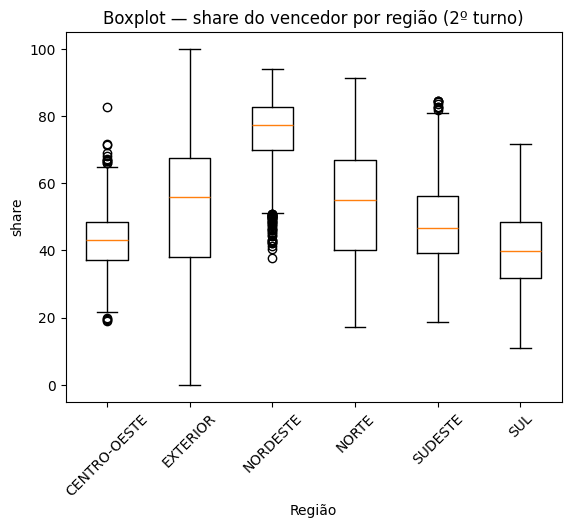
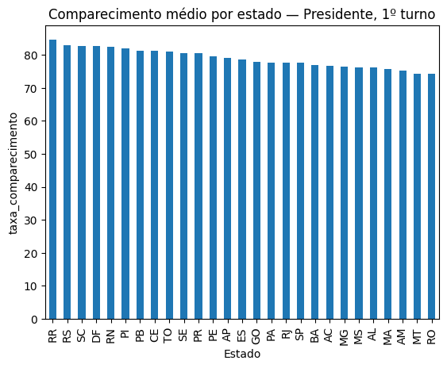

 

<a href="./eda_eleicoes_2022.ipynb">Ver o notebook</a>

 

### Sobre o projeto

Análise exploratória dos dados oficiais do TSE sobre as **Eleições 2022**, feita como checkpoint de Data Science do curso de Engenharia de Software da FIAP. O recorte são os cargos de **Presidente e Governador**, os únicos que tiveram 2º turno, o que permite comparar os dois turnos.

A pergunta que guia o trabalho: **como o Brasil votou, quem foi às urnas, como o voto se dividiu e em quem?**

 

### Os dados

Base *Brazil Elections 2022* (Kaggle), com dados oficiais do TSE. Usamos os 4 arquivos e juntamos os dois tipos numa tabela só:

| | 1º turno | 2º turno |
|:---|:---|:---|
| **Por zona** (quem votou: aptos, comparecimento, brancos e nulos) | `detalhe_votacao.csv` | `detalhe_votacao_2_turno.csv` |
| **Por candidato** (em quem votou) | `votacao_candidato.csv` | `votacao_candidato_2_turno.csv` |

São **21.658 registros de zonas** e **140.620 registros de candidatos**, em 5.613 municípios, nos 27 estados e no exterior.

 

### O que o notebook faz

| Etapa | Conteúdo |
|:---|:---|
| Preparação | Limpeza, testes de consistência (votos dos candidatos batem com os votos válidos) e criação de taxas de comparecimento, abstenção, brancos e nulos |
| Tendência central | Média, mediana e moda |
| Dispersão | Variância, desvio-padrão, coeficiente de variação e quartis |
| Distribuição | Histogramas, assimetria e curtose, com e sem o exterior |
| Correlação | Pearson, gráficos de dispersão e comparação entre os turnos |
| Segmentação | Região, estado, turno, cargo e situação do candidato |
| Outliers | IQR e Z-Score, com estudo de caso |
| Storytelling | Síntese dos achados, limitações e próximos passos |

 

### Principais achados

- **O comparecimento é parecido em todo o país:** média de 78,3%, com metade das zonas entre 75,9% e 82,3%.
- **O voto nulo é o que mais varia** e depende do cargo: 6,98% para Governador contra 2,67% para Presidente no 1º turno.
- **O exterior distorce a distribuição:** comparecimento de 35,9%. Sem ele, o histograma vira quase uma curva normal.
- **A eleição presidencial foi dividida por região:** a mediana de votos do candidato eleito no 2º turno foi de 77,3% no Nordeste e 39,9% no Sul.
- **Quase ninguém mudou de lado entre os turnos:** correlação de 0,995 entre o 1º e o 2º turno, zona a zona.
- **Paradoxo de Simpson:** a correlação entre votos do eleito e voto nulo é positiva no Brasil todo, mas inverte dentro do Nordeste e do Sudeste.
- **Sergipe teve 36,6% de votos nulos para Governador:** o candidato mais votado teve o registro negado e seus votos foram anulados.

 

  
  &nbsp;
  

 

### Tecnologias

  
   
  Python · pandas · NumPy · Matplotlib · Google Colab

 

### Como executar

1. Baixe os 4 arquivos CSV da base *Brazil Elections 2022* no Kaggle.
2. Abra o `eda_eleicoes_2022.ipynb` no Google Colab e envie os arquivos para a pasta `/content`, no mesmo caminho usado na primeira célula de código.
3. Execute as células em ordem.

 

### Equipe

Camile Silva &nbsp;·&nbsp; Gustavo Ferreira &nbsp;·&nbsp; Lucas Caetano &nbsp;·&nbsp; Marco Conte &nbsp;·&nbsp; Sofia Rodrigues

